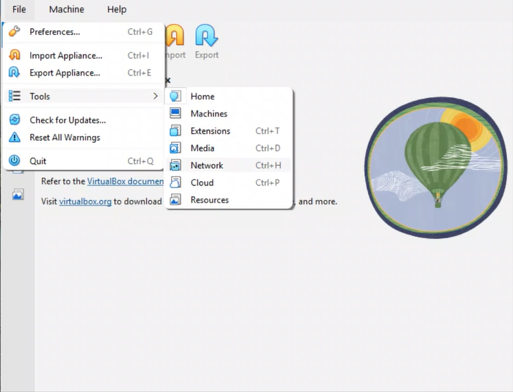

# NETWORKWALKS-B084-WK1-PM1-CYBERSECURITY-LAB-SETUP

## 📌 Project Overview

This project focuses on setting up a **virtual cybersecurity and penetration-testing laboratory** using VirtualBox and Kali Linux.

The purpose of the lab is to create a controlled environment where cybersecurity tools, network scanning, reconnaissance, vulnerability assessment, and other security-testing activities can be performed safely and repeatedly.

The lab is configured on a private virtual network so that additional machines can be added later and used as targets for authorized security testing.

---

## 🎯 Objectives

The main objectives of this project are to:

- Install and configure VirtualBox.
- Install/import Kali Linux as a virtual machine.
- Create a private **NAT Network** for the cybersecurity lab.
- Configure network connectivity for Kali Linux.

---

## Install and configure VirtualBox.

10.Googlecheck.png
11.Snapshot.png
2.NATNetworkSetup1.png
3.NATNetworkSetup2.png
4.NATNetworkVerify.png
5.ImportKaliLinux.png
6.ImportKaliLinux2.png
7.InstallKaliLinux.png
8.NetworkConfiguration.png
9.Troubleshooting.png

---

## Install/import Kali Linux as a virtual machine.
![NETWORKWALKS-B084-WK1-PM1-CYBERSECURITY-LAB-SETUP]
![NETWORKWALKS-B084-WK1-PM1-CYBERSECURITY-LAB-SETUP]
![NETWORKWALKS-B084-WK1-PM1-CYBERSECURITY-LAB-SETUP]

---
## Create a private NAT Network for the cybersecurity lab.
![NETWORKWALKS-B084-WK1-PM1-CYBERSECURITY-LAB-SETUP]

---
## Configure the Kali Linux Network

![NETWORKWALKS-B084-WK1-PM1-CYBERSECURITY-LAB-SETUP]
![NETWORKWALKS-B084-WK1-PM1-CYBERSECURITY-LAB-SETUP]
