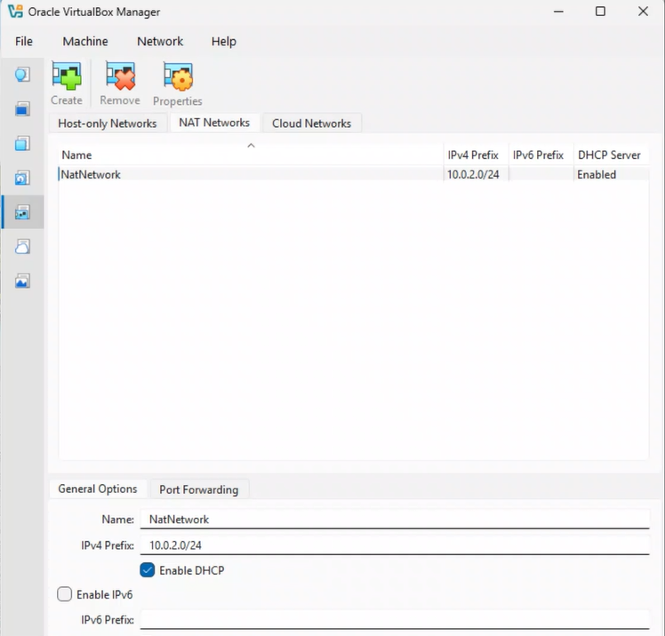
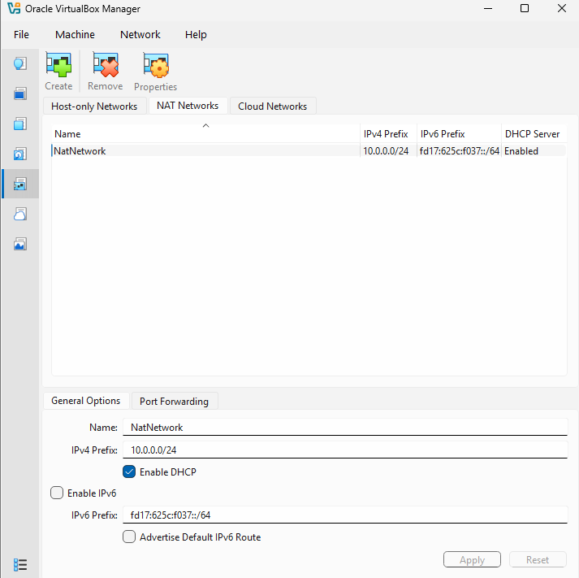
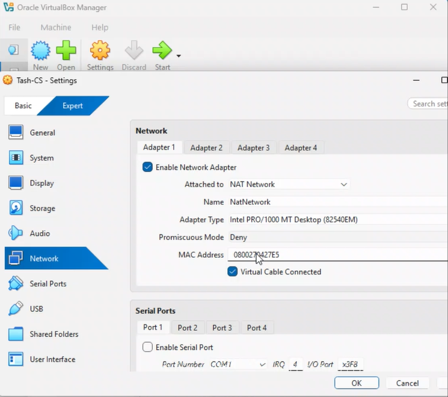
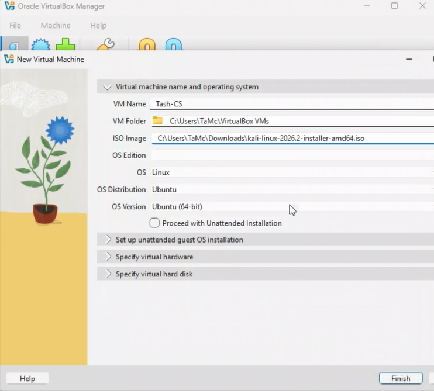
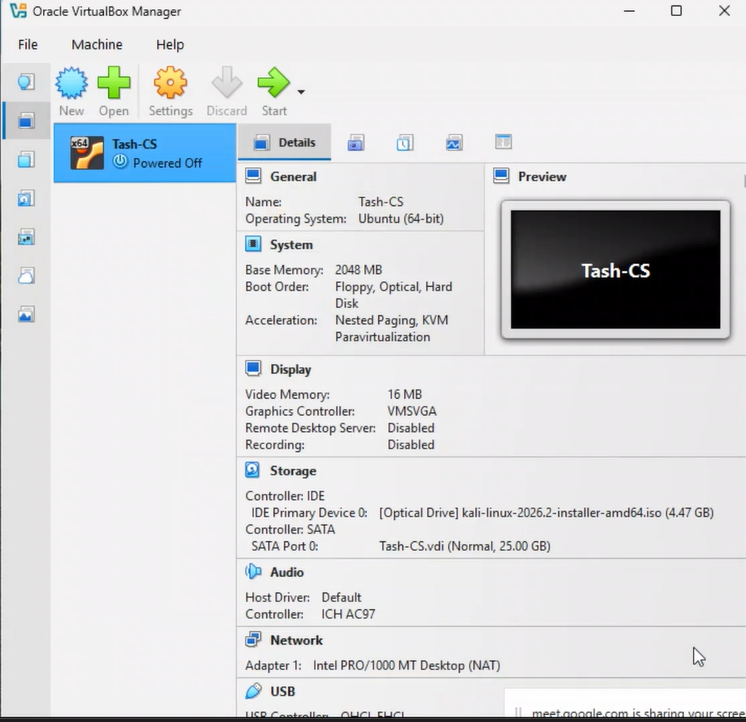
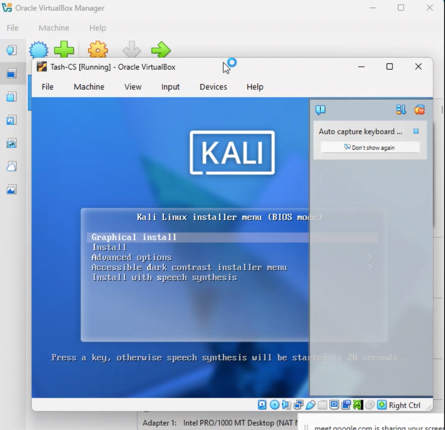
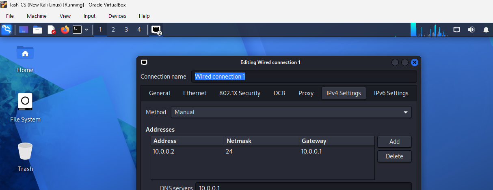
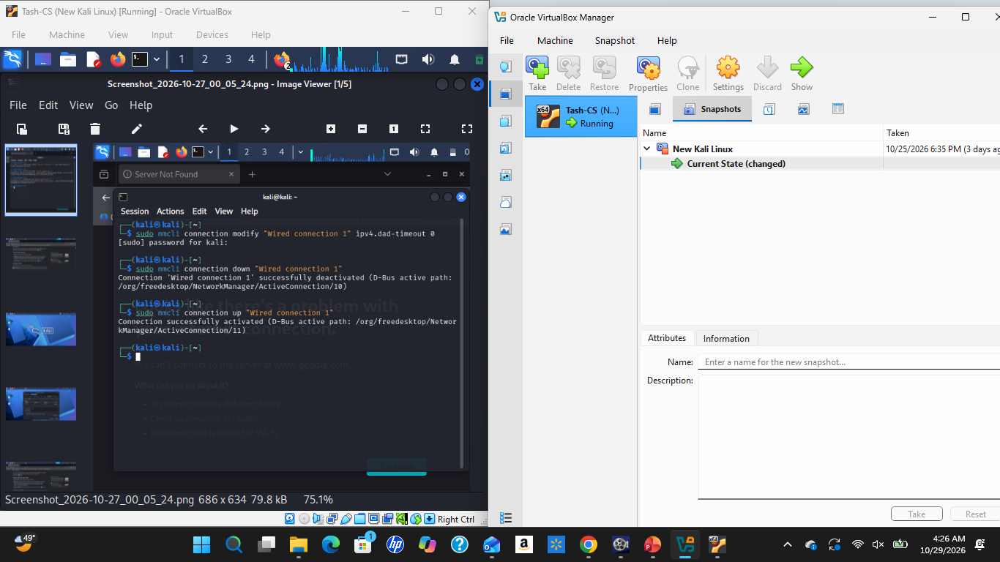
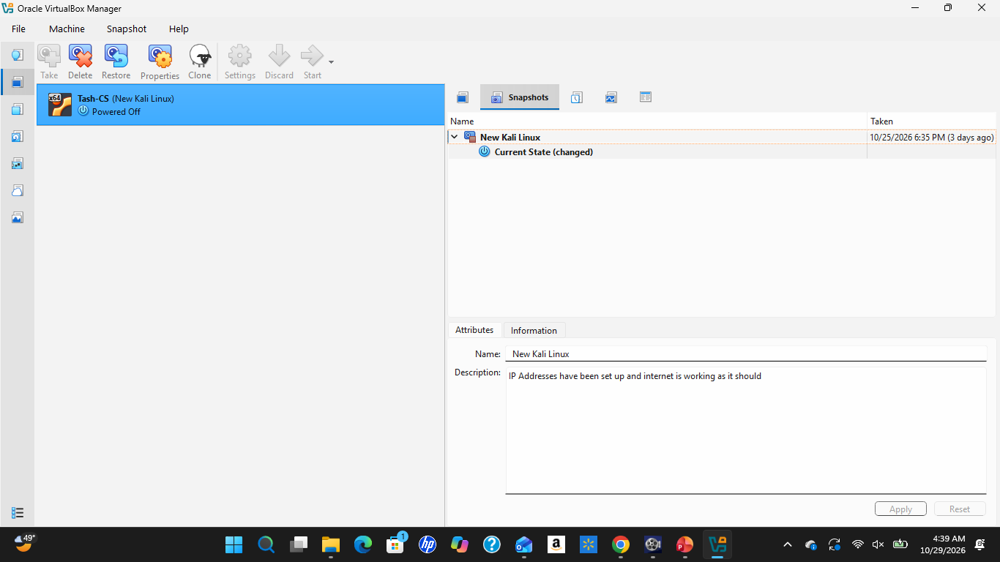

# NETWORKWALKS-B084-WK1-PM1-CYBERSECURITY-LAB-SETUP

## 📌 Project Overview

This project focuses on setting up a **virtual cybersecurity and penetration-testing laboratory** using VirtualBox and Kali Linux.

The purpose of the lab is to create a controlled environment where cybersecurity tools, network scanning, reconnaissance, vulnerability assessment, and other security-testing activities can be performed safely and repeatedly.

The lab is configured on a private virtual network so that additional machines can be added later and used as targets for authorized security testing.

---

## 🎯 Objectives

The main objectives of this project are to:

- Install and configure VirtualBox.
- Install/import Kali Linux as a virtual machine.
- Create a private **NAT Network** for the cybersecurity lab.
- Configure network connectivity for Kali Linux.

---

## Install and configure VirtualBox.

---
## Create a private NAT Network for the cybersecurity lab.

---

## Install/import Kali Linux as a virtual machine.

---

## Configure the Kali Linux Network

---

##**Troubleshoot the Kali Linux Network.**

1

---
##****Virtual Machine Snapshot Creation**

## 📌 Security and Ethical Considerations

This environment is intended for authorized cybersecurity learning and testing.

Cybersecurity tools should only be used against systems and networks for which permission has been granted.

## 🖋️ ****Author****

Tashayna McIntosh

Cybersecurity Trainee B084

LinkedIn:www.linkedin.com/in/tashayna-mcintosh-003661266

## **Conclusion****

This repository documents the lab configuration, setup procedure, and supporting evidence for the week 1 PM1 cybersecurity lab.
